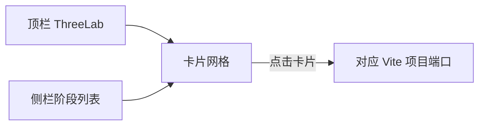

## 画廊壳（像 Cesium 社区页）

布局：




- 顶栏：品牌 `Three Lab`；链接 `Stages` / `Final` / GitHub（占位）
- 侧栏：与文件夹一一对应的分类（01 基础 … 08 Shader、Final）
- 主区：当前分类下的卡片（缩略图占位色块 + 标题 + 一句描述）；点击打开 `http://localhost:517x`（README 注明需先在该目录 `npm run dev`）
- `catalog.ts` 集中维护元数据，后续加示例只改这一处

视觉：深色顶栏/侧栏 + 浅色内容区卡片网格（对齐参考站结构，颜色自定，避免紫渐变模板脸）。

## 各阶 Demo 规格（简单、固定、可口述）


| 目录                   | Demo（固定一种）                                                                  | 练习重点                                  |
| -------------------- | --------------------------------------------------------------------------- | ------------------------------------- |
| 01-basics            | 旋转立方体 + resize                                                              | Scene/Camera/Renderer、Clock、dispose   |
| 02-camera            | 透视场景 + OrbitControls + 一个预设机位按钮                                             | 透视参数、damping、`updateProjectionMatrix` |
| 03-geometry-material | 一排球展示 Basic/Lambert/Phong/Standard                                          | Material 差异、共用 Geometry               |
| 04-light-shadow      | 地面 + 物体 + Directional 阴影                                                    | shadowMap、cast/receive、bias           |
| 05-model-animation   | 加载一个公开 glTF + 播默认 clip                                                      | GLTFLoader、AnimationMixer、包围盒摆相机      |
| 06-interaction       | 多物体 Raycaster 点击高亮                                                          | NDC、误触与拖拽区分                           |
| 07-performance       | 100 Mesh vs InstancedMesh 切换对比 + `renderer.info`                            | draw call、实例化                         |
| 08-shader            | 单个 Fresnel 能量罩球（固定效果https://mp.weixin.qq.com/s/2xj3zPKXu5CZiQTaSHoVig）                                                       | ShaderMaterial、uniform、`uTime`        |
| final                | React 壳 + 手动 `ProductScene`：单模型或单地球 + Zustand 控制 `autoRotate` / `wireframe` | 状态不进 Three 对象、生命周期                    |


Cesium 参考表只作「阶段主题映射」；本仓全部用 Three 实现，不引入 Cesium。

## 统一手写套路（每个练习的 `createApp.ts`）

1. 创建 `Scene` / `PerspectiveCamera` / `WebGLRenderer({ canvas, antialias: true })`
2. `setPixelRatio(Math.min(devicePixelRatio, 2))` + `ResizeObserver` 更新 aspect / size
3. `requestAnimationFrame` 循环；`Clock.getDelta()`
4. `dispose()`：`cancelAnimationFrame`、controls、几何/材质/渲染器
5. `main.ts`：挂载 canvas，`beforeunload` 或模块级清理时调用 dispose

final 额外：`useEffect` 里 `new ProductScene(canvas)`，Zustand 只存布尔/数字，`subscribe` 调 `scene.setParams`，**Mesh 不进 store**。

## README 模板（每阶复制）

```markdown
# 0X - 标题
## 目标
## 实现
## 踩坑
## 面试题（3～5 题口述稿）
```

根 README：路线图 checkbox、端口表、画廊启动方式、Final 说明、选型一句——**样式/物件场景用 Three；真实地理数据用 Cesium**。

## 实施顺序（执行阶段按此落地）

1. 创建 `three-lab` 根目录与根 README
2. 手写 `gallery/`（catalog + 布局样式），可独立跑
3. 脚手架 `01-basics` 完整可跑（含 README），作为后续复制母版
4. 复制母版生成 02～08，按上表填入各自 Demo 与 README 初稿
5. 搭建 `final-product-configurator`（Vite React-TS + zustand + three），单场景 + 2～3 个开关
6. 更新 gallery `catalog.ts` 与根 README 端口/进度表

## 明确不做

- 多风格地球切换 / 商品多配置复杂面板
- R3F、drei、Cesium
- 把 8 阶塞进同一个路由巨型 app
- npm workspaces（首版）

